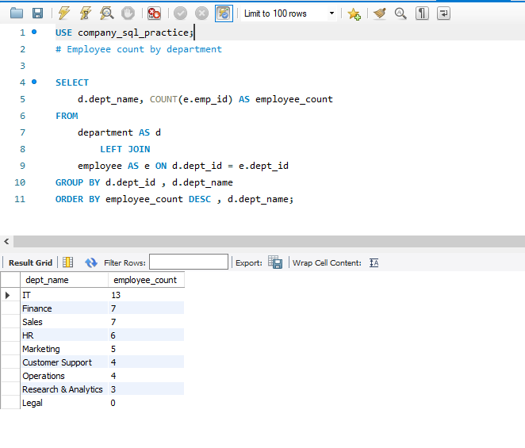
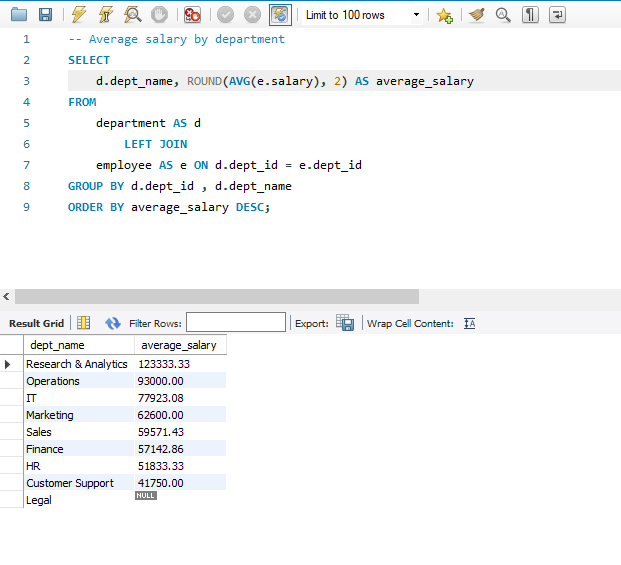
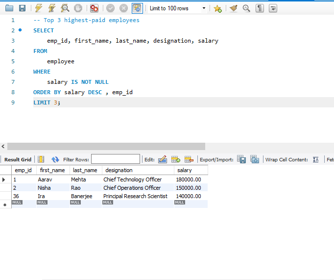
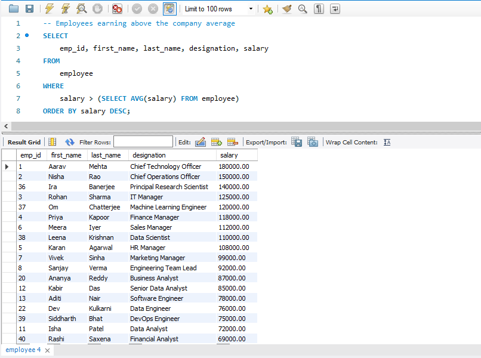
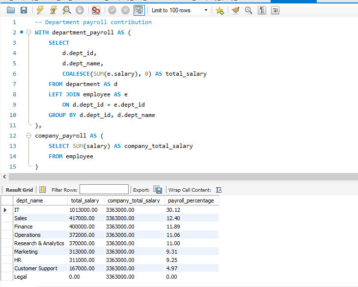
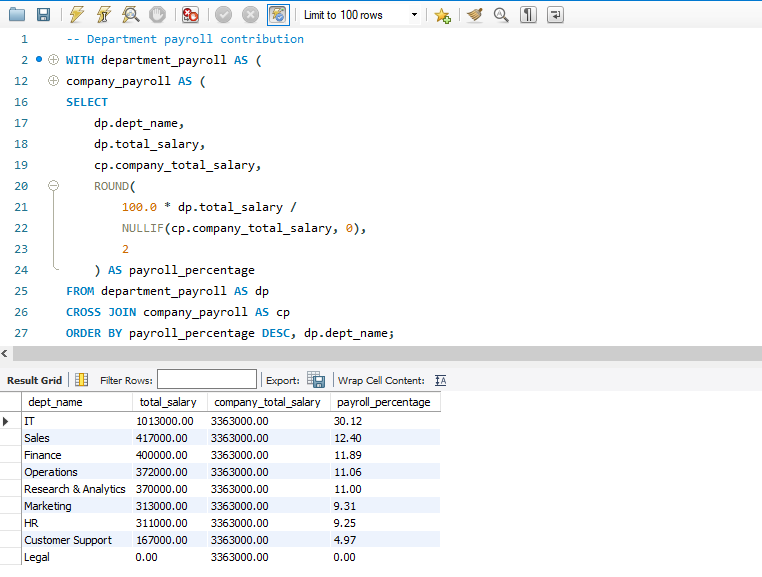

# Company SQL Practice — Employee & Department Analysis

**A MySQL portfolio project by Abhinav Verma**

[](https://www.mysql.com/)
[](#project-objectives)
[](#)

## About Me

I'm **Abhinav Verma**, a **BCA 2nd-year student at the University of Lucknow**, building practical skills in SQL and data analysis.

- **GitHub:** [Abhinav-analyzes9250](https://github.com/Abhinav-analyzes9250)
- **LinkedIn:** [Abhinav Verma](https://www.linkedin.com/in/abhinav-verma9026/)
- **Email:** [av7562469@gmail.com](mailto:av7562469@gmail.com)

## Project Overview

This project explores a sample company database with employee and department information. It uses practical SQL questions to analyse headcount, salary patterns, employee-manager relationships, and departmental payroll. It also includes data-validation exercises for missing values and departments without employees.

**Dataset summary**
- 50 employee records
- 9 departments
- 60 main practice questions, plus 4 additional queries integrated into the main answer file
- Synthetic data created for SQL learning and portfolio demonstration

> **Data note:** This is synthetic practice data, not real company or employee information. Salary figures and employee details are for learning purposes only.

## Project Objectives

- Practise writing readable, maintainable MySQL queries.
- Analyse employee salaries and department-level metrics.
- Use joins to combine employee and department data.
- Apply subqueries, CTEs, and window functions to business questions.
- Validate missing values and departments with no assigned employees.
- Present query outputs as evidence of practical SQL skills.

## Tools & SQL Concepts

**Tools:** MySQL 8.0+ and MySQL Workbench

**Concepts demonstrated:**
- `SELECT`, `WHERE`, `ORDER BY`, `LIMIT`, `BETWEEN`, and `LIKE`
- Aggregate functions: `COUNT()`, `SUM()`, `AVG()`, `MIN()`, `MAX()`
- `GROUP BY`, `HAVING`, and `CASE`
- `INNER JOIN`, `LEFT JOIN`, and self joins
- Subqueries and correlated subqueries
- CTEs (`WITH`) and window functions
- `COALESCE()` and `NULL` handling
- Views, indexes, and data-validation queries

## Database Relationship

```text
department
 ├── dept_id (Primary Key)
 ├── dept_name
 └── one department can have many employees
          |
          | department.dept_id = employee.dept_id
          v
employee
 ├── emp_id (Primary Key)
 ├── dept_id (Foreign Key)
 └── manager_id (employee-to-employee relationship, where populated)
```

## Repository Structure

```text
company-sql-practice/
├── README.md
├── 01_company_schema_and_data.sql
├── 02_company_query_answers.sql
├── 03_company_data_validation.sql
├── PRACTICE_QUESTIONS.md
└── screenshots/
    ├── 01-department-headcount.png
    ├── 02-average-salary-by-department.png
    ├── 03-top-paid-employees.png
    ├── 04-above-average-salary.png
    └── 05-department-payroll-contribution.png
```

## Setup Instructions

1. Install MySQL 8.0+ and open MySQL Workbench.
2. Open `01_company_schema_and_data.sql`.
3. Execute the setup script to create the database, tables, and sample data.
4. Open `02_company_query_answers.sql` and run the queries by section.
5. Run `03_company_data_validation.sql` to inspect data quality.
6. Use `PRACTICE_QUESTIONS.md` to review the practice prompts.

Run the setup script before the query-answer and validation files. Review the SQL before running it in any database containing data you need to preserve.

## Selected Query Results

### 1. Employee Count by Department

Uses a `LEFT JOIN` and aggregation so departments with no employees remain visible.



### 2. Average Salary by Department

Compares average employee salary across departments. An empty department has no average, so its result is `NULL`.



### 3. Top 3 Highest-Paid Employees

Uses filtering, descending sorting, and `LIMIT` to return the three highest non-NULL salary records.



### 4. Employees Earning Above the Company Average

Uses a scalar subquery to compare each employee's salary against the average salary across the company.



### 5. Department Payroll Contribution

Uses CTEs, `SUM()`, `COALESCE()`, and percentage calculation to show each department's share of total salary payroll.





## Example SQL

```sql
SELECT
    d.dept_name,
    COUNT(e.emp_id) AS employee_count
FROM department AS d
LEFT JOIN employee AS e
    ON d.dept_id = e.dept_id
GROUP BY d.dept_id, d.dept_name
ORDER BY employee_count DESC, d.dept_name;
```

This query counts employees in each department and preserves departments with zero employees because it uses a `LEFT JOIN`.

## Data Quality Considerations

- Some fields intentionally contain `NULL` values for practice.
- The dataset includes a department with no employees to test `LEFT JOIN` behaviour.
- `AVG()` ignores `NULL` salary values; an empty department therefore has a `NULL` average.
- `COALESCE()` is used in the payroll example to display zero for departments with no salary total.
- The screenshots show query output from the sample database; results depend on the data loaded locally.

## Key Learning Outcomes

- Translating business questions into SQL queries.
- Combining relational tables and aggregating results.
- Using subqueries and CTEs to calculate analytical benchmarks and KPIs.
- Handling missing data and preserving empty categories in reports.
- Documenting SQL work clearly for review and portfolio presentation.

## How to Use This Project

Clone or download the repository, set up the sample database using the schema-and-data script, and run the queries in MySQL Workbench. You can modify the questions or add your own analyses to extend the project.

## Contact

- **GitHub:** [github.com/Abhinav-analyzes9250](https://github.com/Abhinav-analyzes9250)
- **LinkedIn:** [linkedin.com/in/abhinav-verma9026](https://www.linkedin.com/in/abhinav-verma9026/)
- **Email:** [av7562469@gmail.com](mailto:av7562469@gmail.com)
